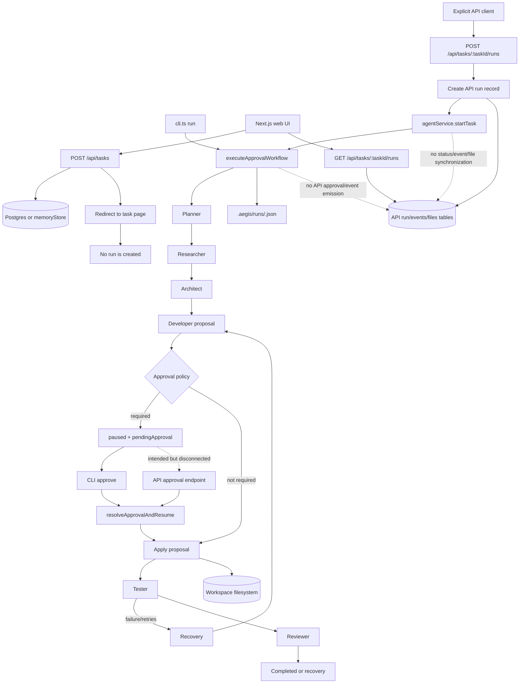

# AEGIS Repository Audit

**Audit date:** 2026-10-12  
**Repository:** `arx-dev15/Aegis`  
**Scope:** Tracked source and documentation, excluding dependencies and generated artifacts (`node_modules`, `.next`, `dist`, `.tmp`, `.gemini`).  
**Method:** Static inspection of entry points, runtime wiring, graph/state flow, API/frontend contracts, tools, persistence, tests, and safe local build/test commands. No source refactoring or feature implementation was performed.

## 1. Executive Verdict

AEGIS contains a substantial, mostly real TypeScript implementation of its agent, graph, repository-intelligence, RAG, memory, GitHub, filesystem, terminal, and approval components. The root CLI-to-LangGraph path is the strongest and most coherent path. Its component tests and root TypeScript build provide useful evidence that many isolated capabilities exist.

AEGIS is **not yet one integrated engineering product**. The web/API path is a separate orchestration surface around the graph rather than a complete product path:

- The web UI creates tasks but does not start runs.
- An explicit API run request can invoke the graph, but graph state is not synchronized to API run/task/event/file/approval records.
- Graph approvals and API approvals are separate state machines.
- The frontend looks for approval events that the graph never emits.
- The graph used by the approval runtime does not visibly route through the Security node or a final verification node.
- The default master test runner reports two failures.
- The dashboard includes intentionally static mock data for several screens.

The correct conclusion is **partially functional and materially disconnected**, not “everything is fake” and not “MVP complete.” The existing codebase can be repaired without a rewrite, but the first repair must establish one shared runtime contract and make the API/web path consume the same run state as the CLI.

## 2. Source of Truth and Audit Conditions

The project documentation itself establishes the right standard: `IMPLEMENTED != INTEGRATED != VALIDATED`, and the MVP requires a real repository, real task, approval, implementation, testing, review, security, verification, and evidence. See [AGENT_BUILD_CONTEXT.md](./AGENT_BUILD_CONTEXT.md), [Must_build.md](./Must_build.md), and [Build_plan.md](./Build_plan.md).

The worktree was already dirty at audit start. Existing modifications were present in:

- `graph/approvalWorkflow.ts`
- `graph/edges/agentRouter.test.ts`
- `graph/proposalApproval.test.ts`
- `graph/state.ts`
- `graph/test.ts`
- `tools/github/github.test.ts`

There were also untracked run snapshots and scratch verification files under `.aegis/runs/` and `scratch/`. These were not changed or removed. Findings below describe the current checkout, including those pre-existing changes, and should be rechecked against a clean revision before release.

## 3. Actual Architecture

### 3.1 Repository structure

The repository has four overlapping architectural layers:

| Area | Actual responsibility | Assessment |
|---|---|---|
| `agents/` | Seven model-backed agent classes, schemas, prompts, and unit tests | Real isolated implementations |
| `graph/` | Multiple historical workflows plus the approval-aware workflow and shared state | Real, but several competing entry points |
| `tools/`, `rag/`, `memory/`, `repo-intelligence/` | Tool safety, retrieval, persistence, repository analysis, and memory capabilities | Meaningful modules, mostly proven only in isolation |
| `apps/api/` + `apps/web/` | Express API/WS server and Next.js dashboard | Separate product surface with incomplete graph integration |

There are also duplicate or historical frontend trees under `apps/web/app` and `apps/web/src/app`, duplicate package boundaries at the repository root and `apps/api`, demos and scratch runners, and a large documentation/history surface. The duplication is not automatically removable; imports and build configuration must be checked before consolidation.

### 3.2 Runtime entry points

| Entry point | Command | What it really does |
|---|---|---|
| Root API | `npm run dev` | Starts `apps/api/server.ts` |
| Root CLI | `npx tsx cli.ts ...` | Connects/indexes repositories, queries intelligence, performs impact analysis, and runs/resumes the approval graph |
| Demo | `npm run demo` | Runs a fixed rate-limiting mission against a temporary workspace or simulation mode |
| Web | `cd apps/web; npm run dev` | Starts Next.js dashboard |
| API-local package | `cd apps/api; npm run dev` | Starts the same Express source through a separate package boundary |
| Test runner | `npm test` | Sequentially invokes a list of isolated test files |

The root `package.json` owns the root graph dependencies and scripts, while `apps/api/package.json` owns a different dependency set and its own build/start scripts. Root `npm start` targets `dist/apps/api/server.js`; API-local `start` targets `dist/server.js`. This is an operationally risky split, not a clean monorepo boundary.

### 3.3 Actual implemented workflow



The CLI path can pause, display an approval, resume, apply approved changes, and persist graph snapshots. The normal web path stops after task creation. The API can start a graph only when a caller explicitly creates a run, and the resulting graph is not reflected back into the API persistence model.

## 4. Feature Reality Matrix

Status meanings follow the repository’s own model: **COMPLETE** means integrated and validated, while **IMPLEMENTED** means isolated behavior only.

| Feature | Claimed capability | Actual status | Evidence and gap |
|---|---|---|---|
| 01 | Gemini model layer | IMPLEMENTED / UNVERIFIED in product flow | Model adapters exist under `models/` and agent classes; no paid live model call was made during this audit. |
| 02 | Structured output | IMPLEMENTED | Agent schemas and structured generation are tested. |
| 03 | Tool system | IMPLEMENTED / PARTIAL integration | Tool registration and invocation exist; the main approval workflow does not use the generic tool-calling loop as its primary control path. |
| 04 | First tool-calling agent | IMPLEMENTED / DISCONNECTED | `agents/agent.ts` and `graph/nodes/agentNode.ts` exist, but the node exposes only the calculator tool and is not the product runtime. |
| 05 | LangGraph state | IMPLEMENTED | `graph/state.ts` has shared annotations, reducers, approval, memory, retry, and evidence fields. |
| 06 | Nodes, edges, routing | IMPLEMENTED | Multiple workflows and routing modules exist and have tests. |
| 07 | Single-agent graph | IMPLEMENTED / HISTORICAL | Exists in `graph/singleAgentWorkflow.ts`; not shown as the web/API product path. |
| 08 | Loops, retries, error handling | IMPLEMENTED / PARTIAL | Recovery routing and tests exist; API-level failure propagation is absent. |
| 09 | Planner | IMPLEMENTED | Model-backed planner and tests. |
| 10 | Researcher | IMPLEMENTED / PARTIAL integration | Can use repository-intelligence context when a matching snapshot is found; API-created tasks do not establish repository context. |
| 11 | Architect | IMPLEMENTED | Model-backed node and tests. |
| 12 | Developer | IMPLEMENTED / PARTIAL | Produces proposed changes; the approval workflow applies them after approval. Repository targeting from API project metadata is not wired into graph state. |
| 13 | Tester | IMPLEMENTED / BROKEN TEST CONTRACT | Real command detection/execution exists, but `graph/terminalWorkflow.test.ts` fails because expected execution logging is not produced by the injected runner path. |
| 14 | Reviewer | IMPLEMENTED / PARTIAL | Reviewer node exists and is tested, but the API path does not persist review output. |
| 15 | Security | IMPLEMENTED / DISCONNECTED FROM APPROVAL GRAPH | `securityNode` and security workflows exist, but the approval graph sequence inspected routes planner → researcher → architect → developer → approval → apply → tester → reviewer; no security node is on that path. |
| 16 | Full multi-agent workflow | IMPLEMENTED / DEMO-VALIDATED | `runDemo.ts` and graph tests exercise it, including simulation mode. This is not proof of web/API MVP integration. |
| 17 | Dynamic routing | IMPLEMENTED | Routing and tests exist. |
| 18 | Failure recovery | IMPLEMENTED / PARTIAL | Recovery node and tests exist; API records do not receive recovery state or final status. |
| 19 | RAG pipeline | IMPLEMENTED / ISOLATED | Loaders, chunkers, embeddings, vector store, retriever, and tests exist; no end-to-end task invocation was verified. |
| 20 | Project knowledge retrieval | IMPLEMENTED / PARTIAL | Repository knowledge retrieval exists and is tested; connection from user-created API project to an indexed repository is absent. |
| 21 | Short-term memory | IMPLEMENTED / ISOLATED | Memory modules and tests exist; graph state contains `memoryContext`, but API persistence does not expose it. |
| 22 | Long-term memory | IMPLEMENTED / ISOLATED | Long-term memory code and tests exist; no product-level lifecycle evidence. |
| 23 | Human-in-the-loop | INTEGRATED ON CLI PATH / DISCONNECTED ON WEB PATH | CLI approval works conceptually; API approval records are not created by graph pauses. |
| 24 | Tool permissions/guardrails | IMPLEMENTED / TEST-FAILING | Dangerous commands and path escapes are blocked. Approval integration test fails on resumed status. |
| 25 | GitHub integration | IMPLEMENTED / PARTIAL | Live client and tests exist; project GitHub endpoint is an isolated read path, not repository setup for graph execution. |
| 26 | Repository intelligence | IMPLEMENTED / CLI-INTEGRATED | `cli.ts connect` scans and stores snapshots; researcher can optionally consume snapshots. API tasks do not connect to this lifecycle. |
| 27 | CLI foundation | INTEGRATED / BEST CURRENT PATH | `cli.ts` exposes connect, status, search, impact, run, and approve. It is the closest thing to a complete AEGIS entry point. |
| 28 | Terminal/sandbox execution | IMPLEMENTED / TEST-FAILING / DEFERRED BY DOCS | Terminal guardrails and workflow code exist, but the master suite includes Feature 28 despite the roadmap saying not to start it, and its workflow test fails. |
| 29 | MCP integration | DEFERRED / NOT IMPLEMENTED | Documentation explicitly says not to start it. |
| 30 | Session runtime/resume/branching | DEFERRED / NOT IMPLEMENTED | Custom run JSON exists, but this is not the documented full session capability. |
| 31 | Observability/token/cost tracking | SCAFFOLD / DEFERRED | `observability/` exists, but no verified product path was found. |
| 32 | Evaluation/benchmarking | SCAFFOLD / DEFERRED | `evaluation/` exists with benchmark/evaluator structure; not part of runtime validation. |
| 33 | Architecture simplification | DEFERRED | Documentation explicitly postpones simplification until after MVP validation. |

## 5. Broken and Disconnected Flows

### 5.1 Web task creation does not start execution

`apps/web/app/new-task/page.tsx` posts a task and redirects. It does not call `taskApi.createRun`, although that method exists in `apps/web/lib/api.ts`. The task page only reads existing runs through `useRun`. Therefore a normal user can create a task and reach a page with no run.

### 5.2 API graph execution is fire-and-forget

`apps/api/services/agentService.ts` calls `executeApprovalWorkflow(...).catch(...)` and immediately returns `{ status: "started" }`. It does not:

- update `memRuns` or `agent_runs` on node transitions;
- update task status to completed, failed, paused, or cancelled;
- persist graph events to `memEvents` or `run_events`;
- persist changed files to `memFiles` or `project_files`;
- persist tests, review, security, recovery, or evidence;
- broadcast completion/failure/pause events.

The API run remains at its initial record state even if the graph completes or fails.

### 5.3 Approval systems are not the same system

The graph creates `pendingApproval` and persists its own run snapshot under `.aegis/runs`. The API approval controller creates `memApprovals` or database rows. No graph callback creates the API approval row when the graph pauses. Conversely, the API approval endpoint resumes the graph only when a caller already knows an API approval ID, which the graph never publishes through the API.

The frontend derives pending approvals from run event metadata. Since graph events are not written to API run events, this UI cannot reliably discover graph approvals.

### 5.4 Security is not in the primary approval graph

The repository has a real `securityNode`, security workflow, security agent, and tests. The inspected `approvalWorkflow.ts` graph construction and routing do not include that node in the post-review path. This means the strongest product claim—security after review before final verification—is not established by the current approval runtime.

### 5.5 Final verification is not a first-class product result

Workspace change evidence is captured around proposal application, which is useful. However, the API does not receive it, and no single final result contract combines plan, applied diff, test output, review, security, approval decision, and evidence for the user.

### 5.6 Live updates are only partial

The API broadcasts WebSocket events for API-created run start/events and approval controller actions. The inspected web task page does not subscribe to WebSocket events and `useRun` does not poll; it only exposes a manual `refetch`. Even the available API broadcasts cannot represent graph transitions because the graph does not emit them into the API layer.

### 5.7 Repository selection is not carried from project to graph

The API project has `repo` and `branch` fields, and the CLI can connect/index a repository. `startTask` passes only task description, run ID, and execution mode to the graph. No project repository path or snapshot identifier is passed. The researcher can only use repository intelligence when it independently discovers a matching snapshot.

## 6. File and Module Audit

| File/module | Actually used? | Finding | Recommendation |
|---|---|---|---|
| `cli.ts` | Yes, direct CLI entry | Strongest integrated path; also contains heuristic workspace discovery and broad orchestration responsibilities | Preserve as a compatibility path; later extract a shared core boundary. |
| `graph/approvalWorkflow.ts` | Yes, CLI and API service | Real approval/apply/persistence runtime, but custom JSON runtime and LangGraph `MemorySaver` are two persistence mechanisms | Make one canonical run-state adapter before adding features. |
| `graph/*Workflow.ts` | Mixed | Several historical/specialized graphs are exported through `graph/index.ts`; not all are product entry points | Verify import reachability before consolidation; label historical workflows. |
| `agents/*` | Mostly tests and graph nodes | Cohesive agent implementations, but model configuration and runtime selection vary by workflow | Retain; integrate through one graph contract. |
| `tools/repoIntelligence` | CLI/researcher usage | Meaningful tool path, but no API project-to-snapshot lifecycle | Connect project/repository setup to snapshot identity. |
| `repo-intelligence/*` | CLI and tests | Broad, substantive repository analysis engine | Preserve; do not call it complete until a real task consumes its evidence. |
| `rag/*` | Tests and selected researcher paths | Retrieval infrastructure exists, but quality/e2e evaluation is not demonstrated | Keep isolated until wired to task context with source evidence. |
| `memory/*` | Graph/tests | Separate short-/long-term memory implementations exist; API does not persist or expose them | Define ownership and run-scoped lifecycle before expanding. |
| `tools/terminal/*` | Tester/workflow/tests | Controlled execution and guardrails exist; test contract currently fails | Fix the execution-log/state contract before treating it as validated. |
| `tools/guardrails/*` | Terminal/filesystem/approval tests | Safety checks block dangerous paths/commands; approval resume test fails | Preserve enforcement at execution boundary and repair resume semantics. |
| `apps/api/*` | API entry | CRUD and transport layer is substantial, but its run state is disconnected from graph state | Make API a thin adapter over shared workflow runtime. |
| `apps/web/app/*` | Next app route tree | Primary app tree uses live API for some pages, but static dashboard screens remain | Replace mock reads only after backend contracts exist. |
| `apps/web/src/*` | Unclear/likely duplicate | Parallel `src/app`, `src/components`, and `src/data` tree duplicates app-side files | Confirm Next resolution and imports, then remove or consolidate in a separate change. |
| `apps/web/data/mock.ts` | Yes for dashboard/agents/settings surfaces | Contains fabricated projects, agents, runs, logs, and system status | Keep only as explicit fixture data; do not present as production state. |
| `runDemo.ts`, `demoGithub.ts`, `demoTerminal.ts` | Direct scripts | Useful demonstrations, not production entry points; simulation mode can produce non-I/O results | Clearly separate demo evidence from MVP validation. |
| `scratch/*` | Not product runtime | Runtime verification experiments and historical checks; untracked files are present | Keep outside production build; clean up only with explicit scope after audit. |
| `observability/*`, `evaluation/*` | No verified product invocation | Future/scaffold surfaces | Do not expand until core workflow is integrated. |
| root and `apps/api` package manifests | Both relevant | Duplicate ownership of API execution/dependencies and incompatible output paths | Choose one workspace/package authority. |

The repository is modular in capability ownership, but fragmented at integration boundaries. The problem is not merely too many files; it is that multiple valid-looking paths do not share one run contract.

## 7. Architecture Problems

1. **Two runtime authorities.** The CLI/graph runtime owns actual workflow state, while the API owns UI-facing run records. Neither is authoritative for the other.
2. **Two approval authorities.** Graph `pendingApproval` and API approval rows represent the same concept with different IDs and lifecycles.
3. **Multiple workflows without a single product selector.** Specialized graphs, multi-agent workflow, dynamic routing workflow, and approval workflow coexist. Tests prove pieces, but the API selects only the approval workflow.
4. **Transport data model is shallower than graph state.** API run records lack plan, research, architecture, recovery, security, approval decision, and change evidence fields.
5. **Package boundary drift.** Root scripts, API-local scripts, dependency manifests, and TypeScript output targets disagree.
6. **Frontend duplication and mocks.** The dashboard has duplicate source trees and static fixtures that make the UI appear more complete than the live path.
7. **Persistence is process/file-local.** `MemorySaver` is process-local and `.aegis/runs` is file-backed JSON. This is useful for a prototype but not a durable multi-process API runtime.
8. **Silent catches exist in persistence and discovery.** Several `catch {}` blocks suppress filesystem/read/persistence failures. This conflicts with the documented no-silent-failure rule and can turn missing evidence into apparently normal execution.

## 8. Agentic System Assessment

The system is genuinely agentic in its isolated core: model-backed agents produce structured outputs, LangGraph passes explicit state, conditional routing and recovery exist, and approval pauses can interrupt/resume the CLI workflow. It is not merely a folder of prompt wrappers.

However, the product-level agentic loop is incomplete:

- The API does not expose graph observations and decisions as run state.
- Repository evidence is optional and not guaranteed for API tasks.
- Tool results and terminal results are not automatically persisted to the API.
- The primary approval graph does not establish a security stage.
- No single result object proves the full lifecycle.
- The generic tool-calling agent is a separate path from the approval workflow.

LangGraph is justified for approval pauses, stateful retries, and conditional recovery. The current number of exported workflow variants is not yet justified by a single user-facing runtime; consolidation should follow evidence, not precede it.

## 9. Tools, Retrieval, Memory, and Safety

### Tools

Filesystem and terminal tools enforce meaningful checks at execution boundaries. The guardrails tests prove dangerous command blocking and path escape blocking. Tool registration exists for generic agent calls and specialized workflow calls. The missing part is result propagation into the API-facing run record.

### Retrieval and repository intelligence

The CLI scans files, parses TypeScript/JavaScript symbols, extracts imports, dependencies, routes, database models, tests, and Git history, builds relationships, and persists JSON snapshots. The researcher can use a matching snapshot. This is substantive functionality. There is no product-level evidence that a task submitted through the web/API selects or consumes the correct snapshot.

### Memory

Graph state, short-term execution memory, long-term memory, repository snapshots, and API records are separate concepts in code. That separation is conceptually healthy, but the API path does not expose or persist graph memory, and the audit found no single lifecycle proving memory improves a real engineering task.

### Safety

The strongest verified safety behavior is command/path policy enforcement and approval-aware file application. Risks remain:

- API auth is a single configurable API key with a development default.
- `apps/api/middleware/auth.ts` exists, but the inspected route mounting does not show `requireAuth` applied to the API router.
- The graph/API workspace boundary is not visibly established when project metadata enters through the API.
- Approval records and graph approval state can diverge.
- Suppressed persistence errors can hide missing audit evidence.

These are architecture and execution-safety findings, not claims of an exploitable vulnerability without a controlled security test.

## 10. Frontend/Backend Integration Assessment

### Works

- Express health endpoint and route registration.
- Project/task/run/approval CRUD contracts in memory or PostgreSQL modes.
- Next API client for projects, tasks, runs, approvals, and activity.
- Project/task pages can read API data when a backend is running.
- API-created runs invoke the graph asynchronously.
- WebSocket server and selected API controller broadcasts exist.

### Does not work end-to-end

- New task → automatic run start.
- Graph run → API run status/events/files.
- Graph pause → API approval record → frontend approval card.
- Graph completion → task/run completion state in the dashboard.
- WebSocket graph progress in the frontend.
- Project repository → repository snapshot → researcher context in API-created run.
- Final result/evidence display from the actual graph.

The dashboard is therefore a partially live CRUD shell around a disconnected execution engine, with additional static/mock screens.

## 11. Test and Runtime Evidence

Commands run without external paid model calls:

| Check | Result |
|---|---|
| Root `npm run build` | Passed (`tsc`) |
| Root `npm test` | Failed: **25 suites passed, 2 failed** |
| `npx tsx tools/guardrails/guardrails.test.ts` | Failed at approval integration: resumed status expected `developing` |
| `npx tsx graph/terminalWorkflow.test.ts` | Failed at Test 1: expected execution log did not contain the command record |
| `cd apps/api; npm run typecheck` | Failed: TypeScript reports imported root `agents/*` files are outside `apps/api`’s configured `rootDir` (`TS6059`) |
| `cd apps/web; npm run build` | Passed: Next production build compiled, type-checked, and generated all seven routes |

The master test runner suppresses child test output and reports only pass/fail, which makes diagnosis slower. It also labels itself Features 01–26 while including Feature 28 terminal tests. Passing suites are predominantly component and mock-model tests; they do not prove a real model-backed, real-repository, web/API end-to-end run.

Unverified during this audit:

- Live Gemini execution.
- PostgreSQL-backed API execution.
- Real browser interaction against a running API.
- Live GitHub calls.
- A successful real engineering task through the web/API surface.
- Crash/restart recovery across processes.

## 12. Simplified Target Architecture

Do not rewrite the repository immediately. Establish one coherent core around the existing implementation:

```text
apps/
  api/                 transport, auth, persistence adapter, WS
  web/                 UI only
core/
  workflow/            canonical state graph and run lifecycle
  agents/              existing agent implementations
  tools/               existing guarded tools
  repositories/        repository connection/intelligence adapters
  evidence/             tests, review, security, final result
```

The current top-level folders can remain during migration. The important ownership rules are:

1. One canonical `RunState` and lifecycle event schema.
2. One workflow start/resume/cancel interface used by CLI and API.
3. API persistence subscribes to that lifecycle rather than reconstructing it.
4. Approval creation/resolution is owned by the workflow runtime and exposed through API adapters.
5. Repository identity/workspace is explicit in run input.
6. Final result includes plan, evidence, approval, applied changes, test result, review, security, and failure/recovery data.

## 13. Repair and Consolidation Roadmap

### P0 — Critical

| Item | Affected files | Dependencies | Risk | Verification |
|---|---|---|---|---|
| Establish one run lifecycle adapter between graph and API | `graph/approvalWorkflow.ts`, `apps/api/services/agentService.ts`, `apps/api/controllers/runs.ts`, `apps/api/services/memoryStore.ts` | Define event/status/result contract | Medium; API compatibility | Start a run via API and observe running, paused, completed/failed, events, files, and evidence in one record. |
| Make web task creation start the run or explicitly require a start action | `apps/web/app/new-task/page.tsx`, `apps/web/lib/api.ts` | Lifecycle adapter | Low | User submits a task and sees a real run without a second undocumented API call. |
| Unify graph/API approvals | `graph/approvalWorkflow.ts`, `apps/api/controllers/approvals.ts`, `apps/web/app/tasks/[id]/page.tsx` | Run lifecycle adapter | High; state migration | Graph pause creates visible API approval; approve/reject through UI resumes the same run exactly once. |
| Repair current failing approval and terminal contracts | `graph/approvalWorkflow.ts`, `tools/guardrails/guardrails.test.ts`, `graph/nodes/testerNode.ts`, terminal tests | No new feature | Low | Targeted tests pass and master suite remains green. |
| Put security and final verification on the actual product path | `graph/approvalWorkflow.ts`, security/verification nodes | Canonical state/result contract | Medium | Real approved change produces persisted security and final verification evidence. |

### P1 — Essential

| Item | Affected files | Dependencies | Risk | Verification |
|---|---|---|---|---|
| Pass explicit project repository/workspace/snapshot identity into runs | API project/task/run controllers, graph state, researcher node | Repository identity contract | Medium | Research evidence references the selected repository and relevant files. |
| Persist graph transitions, tool results, tests, review, security, recovery, and diff evidence | API controllers/services, graph nodes | Lifecycle adapter | Medium | API and CLI show the same run result. |
| Add cancellation, restart, and durable resume semantics | `agentService.ts`, graph runtime, persistence | Canonical run storage | High | Kill/restart process and resume a paused run without losing approval state. |
| Add frontend live updates | `apps/web/hooks/useRun.ts`, task page, WS client | Event schema | Low | UI updates on graph events without manual refresh. |
| Apply auth middleware consistently | API route mounting and frontend request headers | Auth decision | Medium | Protected endpoints reject missing/invalid keys and frontend uses configured credentials. |

### P2 — Consolidation

| Item | Affected files | Dependencies | Risk | Verification |
|---|---|---|---|---|
| Select one package/workspace authority | root package files, `apps/api/package.json`, tsconfigs | Build matrix | Medium | Root/API/web builds use documented commands and matching output paths. |
| Remove or archive duplicate frontend tree after import audit | `apps/web/app`, `apps/web/src` | Confirm Next resolution | Medium | Web build and route smoke tests pass with one route tree. |
| Reduce competing workflow exports to supported workflows | `graph/index.ts` and historical workflow files | Runtime usage map | Medium | No supported import breaks; each retained workflow has a named consumer. |
| Separate demos/fixtures from product data | `runDemo.ts`, `apps/web/data/mock.ts`, scratch files | Live API contracts | Low | Production pages never display fabricated state by default. |
| Replace silent persistence catches with explicit diagnostics | graph runtime, CLI, repository adapters | Logging policy | Medium | Forced persistence failure reaches run failure/evidence rather than success-shaped output. |

### P3 — Improvements

- Add integration tests using a local fixture repository and mocked model boundary.
- Add contract tests between API event schemas and web types.
- Add structured observability after the core lifecycle is reliable.
- Add evaluation benchmarks only after a real end-to-end task can produce evidence.
- Add performance limits, workspace cleanup, and bounded output policies.

## 14. Final Assessment

1. **What works today?** The root TypeScript build, many isolated agent/graph/tool/RAG/memory/repository-intelligence capabilities, CLI repository indexing/querying, and the CLI-oriented approval workflow.
2. **Which features exist mostly on paper?** Product-level end-to-end MVP, web/API execution lifecycle, durable session semantics, observability, evaluation, and the documented final result/evidence contract.
3. **Which features are implemented but disconnected?** API run persistence, frontend run creation/live updates, API approvals, security in the primary approval graph, repository intelligence from API projects, and several memory/RAG paths.
4. **What is unnecessarily complicated?** Multiple workflow variants, duplicate package boundaries, duplicate frontend trees, two approval authorities, two run persistence authorities, and broad barrel exports without one product selector.
5. **What is duplicated?** Frontend route/component/data trees; root/API package scripts and dependency ownership; graph workflow variants; API run state versus graph run state; API approvals versus graph approvals.
6. **What is missing?** A shared run lifecycle contract, API-to-graph repository context, graph-to-API event/result propagation, real web approval wiring, security/final verification in the product path, and durable restart semantics.
7. **Can it be repaired without a rewrite?** Yes. The existing graph, agents, tools, and repository intelligence are sufficient foundations. The highest-risk work is state/lifecycle integration, not replacement.
8. **What should development stop doing immediately?** Adding numbered features, demos, or parallel abstractions before proving one real task through the shared runtime; treating isolated tests or mock dashboards as MVP evidence.
9. **What minimum coherent system should be preserved?** CLI/API task entry, explicit repository/workspace identity, repository intelligence, planner/researcher/architect/developer, guarded approved apply, tester, reviewer, security, final evidence, and one durable run record.
10. **What exact repair sequence has least risk?** First repair failing tests and define the run event/result contract; then connect API `startTask` to lifecycle persistence; then wire web task creation and approvals; then add repository identity and security/final verification; then validate against a fixture repository; only afterward consolidate duplicate modules and add deferred capabilities.

**Bottom line:** preserve the core and integrate it. A rewrite would discard working capabilities before the actual product boundary has been made coherent.
